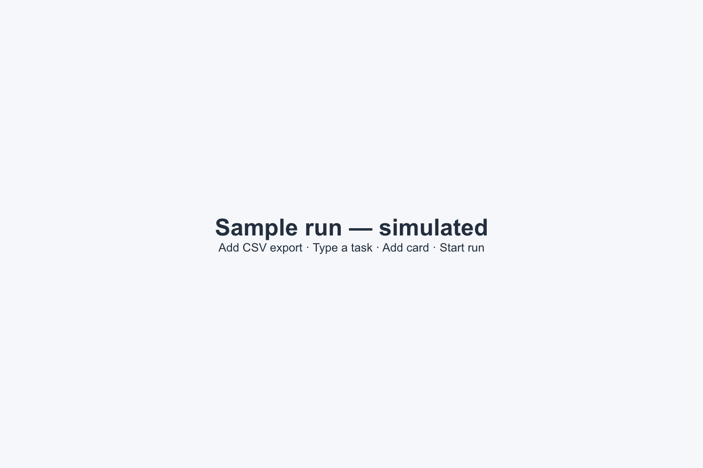
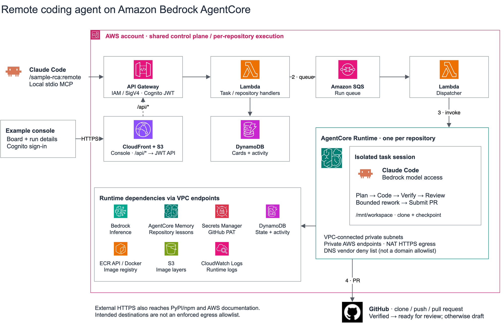

# Remote coding agent on Amazon Bedrock AgentCore

**Turn a coding task into a pull request. Keep your laptop free.**

[](LICENSE)
[](#before-you-start)
[](#who-is-this-for)

Submit from Claude Code or the web UI, follow the remote agent's progress, and get a PR with verification evidence powered by Amazon Bedrock AgentCore Runtime.



*Sample run — simulated: add CSV export to an expense tracker.*

[Quick start](#quick-start) · [Web UI](#option-a-web-ui) · [Claude Code](#option-b-claude-code) · [Architecture](#architecture) ·
[Costs and cleanup](#costs-and-cleanup) · [Contributing](#contributing)

## Who is this for?

For **developers** delegating scoped features, bug fixes, and tests, and **platform engineers**
exploring AWS-hosted coding agents with repository-scoped execution and a shared task console.

## Why use it?

- **Keep working while the agent runs.** Submit a task and let remote execution handle the loop.
- **See what happened.** Follow planning, coding, verification, and review from one board.
- **Review the result in GitHub.** Get a PR with verification evidence and an explicit draft outcome when checks do not pass.
- **Own the deployment.** Each repository gets its own AgentCore Runtime and Memory in your AWS account.

**Use trusted repositories in a dedicated AWS account.** This sample executes repository code;
it does not make untrusted code safe. A runtime or publishing failure may produce no PR.

## Quick start

### Before you start

- A dedicated AWS account, with credentials for your intended profile and region.
- Docker running, Python ≥ 3.11 (tested with 3.12), `uv`, Node ≥ 20, and the AWS CLI.
- A trusted, disposable repository and a **GitHub PAT**. A classic token with the `repo`
  scope is the quickest — the console links to a page with it pre-ticked — but it is not
  limited to one repository; see [Token scope](#token-scope-read-this). A fine-grained token
  with `contents: write` and `pull requests: write` is the tighter choice.

Preflight checks AgentCore/model availability and prints any required CDK bootstrap command.
The ~1.3 GB ARM64 image builds locally. Claude Code is optional; the web UI works without it.

### Deploy it

1. **Deploy the fleet.**

   ```bash
   git clone https://github.com/aws-samples/sample-remote-coding-agent
   cd sample-remote-coding-agent
   make setup
   make preflight
   make deploy EMAIL=you@example.com
   ```

   **Read the account and region from `make preflight` before deploying.** Preflight is read-only;
   deploy starts spending without confirmation. Allow **15–25 min**, mostly the local image build.
   On completion it prints the console URL, API URL, and region. Check known issues if it stalls.

2. **Sign in at the console URL.** Cognito emails a temporary password to `EMAIL`; check spam and change it on first sign-in.

3. **Register a disposable repository** with **+ Add repository**. Enter its URL and PAT;
   leave Advanced folded. Wait **2–5 min** for `READY`; starting sooner returns `409 ConfigurationNotReady`.

   The agent pushes branches and opens PRs. Start with a small repository whose tests already
   pass. Declare setup/test entry points so verification can run:
   [command detection details](CLAUDE.md#why-the-makefile-targets-are-named-that-way).

### Choose how to submit tasks

**One deployment, two entry points.** Both queue the same remote agent pipeline and produce
cards on the same board. Registration is done once in the console, whichever path you use.

| Entry point | Best when | What you need |
|---|---|---|
| [Web UI](#option-a-web-ui) | You want to compose tasks and watch them on a board | Console sign-in; no local Claude Code installation |
| [Claude Code](#option-b-claude-code) | You want to delegate without leaving your terminal | Plugin and AWS credentials for the deployed fleet |

### Option A: Web UI

Open your repository's board. Type the title on the first line and the description below it.
**Illustrative example from the GIF:** this task assumes an expense-tracker app, which this
repository does not include. Write a task that fits your own registered repository.

```text
Add CSV export
Add a Download CSV button to Expenses.
Export date, category, and amount.
Test CSV escaping and empty exports using the existing test runner.
```

Click **Add card**, then **Start run** (or drag Backlog → Planning). **Add and start** does
both at once. Watch **Planning → Coding → Verifying → Done** and click the status for details.

### Option B: Claude Code

4. **Install the plugin, then restart Claude Code.** Web-only users can skip this step.

   ```text
   /plugin marketplace add aws-samples/sample-remote-coding-agent
   /plugin install sample-rca@sample-remote-coding-agent
   ```

   Leave the config fields empty for discovery. `RCA_API_URL`, `AWS_REGION`, and
   `RCA_STACK_NAME` overrides **outrank** discovery and may select another fleet.
   Check the `endpoint used:` line. Restarting loads the plugin's MCP tools.

```text
# Optional: scaffold an empty repo locally, then push it before dispatch.
/sample-rca:scaffold
# Example: build a 2048 game in your registered disposable repository.
/sample-rca:remote Build a 2048 game as a Vue 3 single-page app. Keep the board and merge
logic in a plain module with Vitest tests covering spawn, merge, win and game over. Add
scripts.setup, scripts.test and scripts.dev to package.json, and a README whose first
section is the exact commands to install it, run it in a browser, and test it.
# Check progress here or in the web UI; the task appears in both.
/sample-rca:remote status
```

### Review the result

Queue acknowledgment takes seconds; execution can take tens of minutes. Unverified runs open **draft PRs**.
**Reviewing** and **Submitting** are statuses within Verifying. Done alone is not
proof of success: `SUCCEEDED` means a verification command ran and review judged it green.
Follow **Open pull request**, inspect the diff and evidence, and merge only after human review.

## Architecture



[Editable draw.io source](assets/architecture.drawio) · [Asset sources](assets/README.md#architecture)

The local MCP server uses an IAM-authorized API; the browser uses CloudFront/S3 and a
Cognito-authorized API. Both reach Lambda and SQS. Each repository owns a Runtime;
tasks run in isolated sessions with a clone and checkpoint under `/mnt/workspace`.

The agent runs **checkout → plan → code → verify → review → submit**, with bounded rework.
It writes status/activity to DynamoDB; the console polls through the API. AgentCore Memory
is created at registration and deleted at deregistration. Tasks can retrieve earlier lessons;
a repository without memory runs without it.

VPC endpoints connect runtime traffic to **Bedrock, AgentCore, Secrets Manager,
DynamoDB, ECR API/Docker, S3, and CloudWatch Logs**. Lambda runs outside the agent VPC.
GitHub receives source code through clone/push/PR traffic. Package installation reaches
PyPI/npm, and the documentation tool reaches AWS documentation. These are intended destinations,
**not an enforced domain allowlist**: NAT permits outbound TCP 443, and the DNS firewall
blocks named vendor domains only. [Boundary details](CLAUDE.md#the-boundary-claim-and-where-it-is-qualified)

## Costs and cleanup

NAT gateways, interface VPC endpoints, WAF, images, logs, and stored data can cost money
even between tasks. Tasks add Runtime, Bedrock, and memory usage. No measured whole-stack
monthly or per-task cost estimate is published yet.

The default **$200 monthly Bedrock budget sends email notifications**, not a hard spending
cap, and does not cover every service. Monitor your actual account charges.
[Budget configuration](infra/stacks/account_stack.py)

Deregister every repository in the console **first** — settings → **Deregister**, 1-3 min each —
and only then destroy the stacks. The other order orphans the runtime, the IAM role and the
secret, which no stack owns and which keep costing money. Follow the
[exact five-stack teardown commands](CLAUDE.md#tearing-a-fleet-down) for your prefix and region.
Stack deletion retains tables, the Cognito pool, access logs, bootstrap ECR images, and runtime
log groups. Review the [retained-resource cleanup table](CLAUDE.md#what-deliberately-survives-a-destroy)
before deleting them; some are the only history of your runs.

## Troubleshooting

- **A tool recommends `/sample-rca:setup`.** That command is gone; run `make deploy EMAIL=you@example.com` from a checkout.
- **Console returns AccessDenied XML.** Check that deployment uploaded `index.html` before changing IAM.
- **Temporary password expired.** Redeployment does not resend it; see [operator recovery notes](CLAUDE.md#what-the-walkthrough-touches-and-where-it-lives).
- **Tools succeed but the board is empty.** Check `endpoint used:` and stale API overrides for another deployment.
- **Another `/remote` command answers.** Use `/sample-rca:remote`; other plugin namespaces are unrelated.

Check current setup issues before deploying: [VPC quota](https://github.com/aws-samples/sample-remote-coding-agent/issues/2), [Cognito domain](https://github.com/aws-samples/sample-remote-coding-agent/issues/3),
[deployment](https://github.com/aws-samples/sample-remote-coding-agent/issues/5), [wrong-account handling](https://github.com/aws-samples/sample-remote-coding-agent/issues/7), [account selection](https://github.com/aws-samples/sample-remote-coding-agent/issues/8).

## Contributing

Run `make setup`, `make test`, and `make lint`. Local tests use fake AWS services, not a deployed fleet.
See [contribution guidelines](CONTRIBUTING.md), [code of conduct](CODE_OF_CONDUCT.md),
and [maintainer reference](CLAUDE.md). Keep diagrams and previews in sync with UI changes.

## Token scope: read this

The console offers two credentials and they are **not** equivalent.

| | classic PAT (`ghp_…`) | fine-grained PAT (`github_pat_…`) |
|---|---|---|
| to create | ~3 decisions, scope pre-ticked from the console link | ~9 decisions, no prefill possible |
| reach if leaked | **every repository its owner can access** | the one repository you selected |
| scope to set | `repo`, or `public_repo` for a public repository | `contents: write`, `pull requests: write` |

A classic token **cannot be limited to one repository.** GitHub does not offer that, so a
classic token registered here can read and write everything its owner can reach. This system
runs an arbitrary repository's own setup and test commands with a model pointed at them, and
it does not prevent prompt injection — so treat the token as reachable by that code.

Both are accepted because the fine-grained flow was turning people away before they saw a
single run: nine decisions in a list of about fifty permissions, none of which can be
pre-filled from a link. The classic page can be, so it is one click from Generate.

**If you use a classic token, use a GitHub account that owns nothing you mind losing.** That
is the same bound this sample already asks for on the AWS side — a dedicated account — and it
is what makes the wider scope survivable rather than merely convenient. For anything else,
spend the extra clicks on a fine-grained token.

GitHub App and OAuth tokens (`ghs_`, `ghu_`, `ghr_`, `gho_`) are refused, and not on security
grounds: they expire an hour after issue and nothing here refreshes one, so registration
would succeed and every task an hour later would fail inside a container.

## Limitations

- **The token is minted by hand.** GitHub has no API to create a PAT, so this cannot be
  automated. The alternative is a GitHub App, which needs an App registered and installed
  before the first repository can be added — more setup than it saves for one repository.
- **A classic token's blast radius is its owner's whole account**, as above.
- **Commit attribution** defaults to an address that matches no GitHub account, so checks
  that gate on it will refuse the agent's pull requests. Pass `-c gitAuthorName=` and
  `-c gitAuthorEmail=` at deploy time to fix it.
- **AgentCore Runtime V2 only**, so deployment is limited to `us-east-1`, `us-east-2`,
  `us-west-2`, `eu-west-1` and `ap-northeast-1`.
- **Memory is implemented and undemonstrated**: no run has yet shown one task recalling what
  another wrote, and events expire after 90 days.

## Security

Protect the default branch of the repository you register. Read [Token scope](#token-scope-read-this)
before choosing a credential.
The account boundary does not stop repository code from making outbound HTTPS requests.
[Remaining exposure](CLAUDE.md#what-remains-exposed)

Bedrock invocation logging is a retention choice; default `global.` inference profiles can
serve outside your deployment region. Review the
[logging qualification](CLAUDE.md#qualification-1--model-invocation-logging-is-a-retention-choice)
and [data residency](CLAUDE.md#data-residency) before sending sensitive code.

See [CONTRIBUTING](CONTRIBUTING.md#security-issue-notifications) for more information.

## License

This sample uses the [MIT-0 License](LICENSE). See [attribution](assets/README.md#architecture) for third-party artwork rights.
